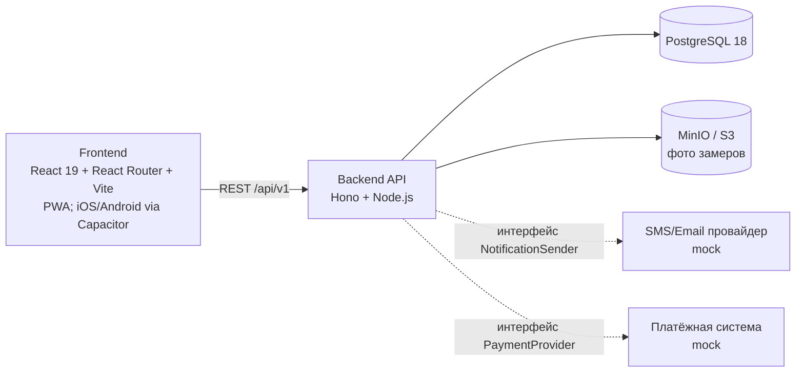
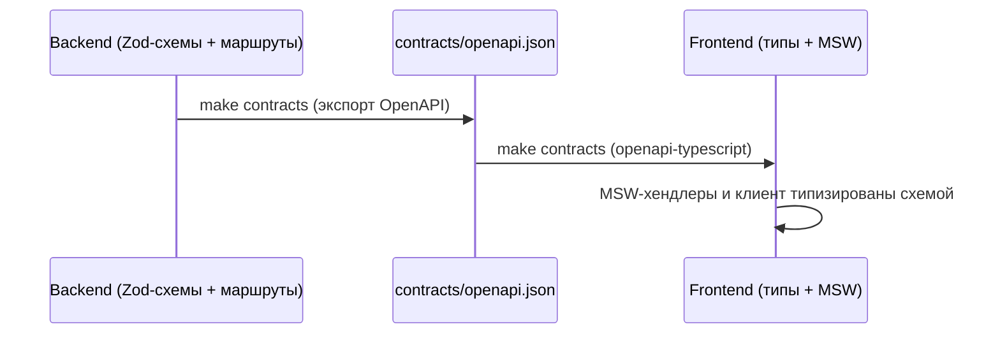

# DopaFit — архитектура

## Обзор системы



Сервисы (docker compose): `postgres`, `minio`, `backend` (:8000), `frontend` (:5173 dev).
В проде это один образ: Hono отдаёт и API, и собранную PWA с того же origin, поэтому
кросс-доменных запросов и CORS нет. Фоновые задачи выполняются внутри приложения.

## Контрактный workflow



- Контракт и типы — генерируемые артефакты: править их руками нельзя, только `make contracts`.
- CI падает, если повторная генерация даёт diff с закоммиченными `contracts/openapi.json`
  и `frontend/src/shared/api/schema.d.ts`.
- Composition root требует обработчик для каждого маршрута: незакрытая операция роняет
  приложение на старте, а не отдаёт заглушку в рантайме.

## Backend

### Слои

Код разбит на предметные модули (`auth`, `training`, `commerce`, `messaging`),
внутри каждого — одинаковые слои:

```
application    — сценарии: бизнес-логика, проверки прав (тренер↔клиент), транзакции
  ↓
domain         — чистые правила и типы; не знают о БД, HTTP и фреймворке
  ↑
infrastructure — репозитории (Drizzle), реализации портов
```

Одна операция описана в одном месте: `endpoint` (`src/endpoint.ts`) связывает маршрут
(путь, схемы, ответы) с обработчиком, который его реализует, — контракт и код не могут
разойтись. Этот словарь объявления лежит на верхнем уровне, вне `http/`, поэтому модуль
пользуется им, не завися от HTTP-слоя.

Каждый модуль объявляет свои операции сам: и объявления, и DTO лежат в
`src/modules/<module>/http/`. Общего файла схем больше нет — DTO принадлежит тому модулю,
чьи операции его называют. Те немногие имена, которые действительно общие для двух модулей
(`AccountRole`, `PHONE_PATTERN`, `ErrorResponse`, `OkResponse`), объявлены в `src/endpoint.ts`:
так оба модуля называют одно и то же, не импортируя схемы друг друга.

Это не только договорённость: правило ESLint запрещает файлу из `src/modules/<a>/**`
импортировать `src/modules/<b>/**` при `<b> ≠ <a>` — включая `import type`. Модулю доступны
только он сам, `src/domain/**`, `src/endpoint.ts`, `src/limits.ts`, npm-пакеты и (из
`infrastructure/`) `src/platform/**`. Связывает модули между собой composition root
(`src/runtime.ts`), который лежит вне `src/modules/` и потому правилом не затронут.

`src/http/` — это диспетчер и только он: адаптер запрос→обработчик (`app.ts`), сборка
контракта (`schema-discovery.ts`, `zod-introspection.ts`), общий список операций
(`endpoints/index.ts`) и проверка живости процесса (`endpoints/health.ts`, единственная
операция, у которой нет предметного модуля). Правило ESLint запрещает `src/modules/**`
импортировать `src/http/**` — без единого исключения: модуль объявляет свои операции сам,
но ничего не знает о диспетчере. Внутри модуля `<module>/http/` — такой же слой адаптера, как
`infrastructure/`: им нельзя пользоваться из `domain/` и `application/`.

Domain и application зависят от интерфейсов (портов), а не от конкретных реализаций;
их подставляет composition root (`src/runtime.ts`). Транзакции и блокировки — через
небольшой unit of work. Поддерживающие модули: `src/config.ts`,
`src/platform/` (БД, storage).

`platform/` называется так, а не `infrastructure/`, чтобы отличаться от одноимённого
слоя внутри модуля: это инфраструктура процесса (подключение к БД, объектное хранилище),
а `<module>/infrastructure/` — репозитории конкретного модуля. Раньше оба назывались
одинаково и различались только числом `../` в импорте.

### Структура пакета

```
backend/src/
├── server.ts            # entrypoint: HTTP-сервер, планировщик, graceful shutdown
├── runtime.ts           # composition root: сборка модулей, middleware, раздача PWA
├── config.ts            # конфигурация из env + валидация прод-настроек
├── domain/              # общие примитивы (ошибки, principal)
├── http/                # диспетчер: адаптер запрос→обработчик, сборка контракта
│   └── endpoints/       # общий список операций (index.ts) и проверка живости (health.ts)
├── platform/            # подключение к БД, схема Drizzle, миграции, seed, storage
├── endpoint.ts          # словарь операции: EndpointInput, endpoint(), requirePrincipal
│                        # + немногие общие для модулей DTO (AccountRole, PHONE_PATTERN)
├── limits.ts            # предельные размеры запроса (нужны и config, и training)
└── modules/             # предметные модули
    └── <module>/        # domain / application / infrastructure
                         # + http/ — свои эндпоинты и DTO (у training — по поддоменам)
backend/drizzle/         # миграции
backend/tests-ts/        # vitest
backend/scripts/         # export-openapi.ts
```

### Аутентификация

- Регистрация: контакт (телефон/email) → код верификации (dev: `000000`, лог) → пароль → онбординг-данные.
- JWT access (15 мин, payload: `sub`, `role`) + refresh (30 дней, ротация, хранится хэш в БД, отзыв при logout/смене пароля).
- Восстановление пароля — тот же механизм `verification_codes` с `purpose=password_reset`.
- Ответы не раскрывают существование аккаунта; отправка кодов ограничена по контакту и по IP.

### Доступ тренера к данным клиента

Все сервисы, принимающие `client_id`, проверяют активную связь в `trainer_clients` (status `active`, trainer = текущий пользователь). Управляемые клиенты без аккаунта (`client_user_id IS NULL`) принадлежат тренеру полностью.

## Администрирование

Админ-панели сейчас нет: SQLAdmin удалён вместе с Python-реализацией. Что изменилось:

| Было (SQLAdmin) | Стало |
|---|---|
| Общий каталог упражнений и стандартные программы | наполняются сидированием (`make be-seed`) |
| Управление пользователями и подписками вручную | недоступно |
| Ответы на обращения в поддержку, рассылки | недоступно |

Пользовательские обращения, автоматические уведомления, платёжные webhook и
реферальные начисления работают как прежде. Замена — отдельная CRM, см. `techdebt.md`.

## Frontend

### Feature-Sliced Design

```
frontend/src/
├── app/        # инициализация: роутер, QueryClient, тема, MSW-бутстрап
├── pages/      # экраны (1 экран спеки = 1 page), сборка из features/entities
├── features/   # пользовательские сценарии (auth/login, measurements/save-form)
├── entities/   # доменные сущности: api-хуки (TanStack Query), типы, mocks
└── shared/     # ui-kit, api-клиент + сгенерированная схема, lib, config
```

Правило импортов — только вниз: `app → pages → features → entities → shared`.
Слайс не импортирует соседний слайс напрямую: публичная часть выносится в `@x`.
Направление проверяется собственным eslint-правилом (`frontend/eslint-rules/fsd.js`)
и падает как ошибка линта, а не остаётся договорённостью.

### Данные и состояние

- **TanStack Query** — всё серверное состояние (ключи кэша по entity: `['measurements', userId]`...).
- **Zustand** — только клиентское состояние (текущая сессия тренировки до синка, UI-настройки).
- **MSW v2** — dev-моки и тестовые моки из одних хендлеров; включение: `VITE_API_MOCK=true`. Хендлеры типизированы сгенерированной схемой.
- Готовность к React Native: `entities`/`features` не используют DOM напрямую; платформенные вещи (storage, share) — за адаптерами в `shared/lib/platform`.

### UI

- Собственные UI-примитивы поверх обычного DOM в `shared/ui` (`Button`, `Input`, `Dialog`…).
  Прикладной код импортирует их оттуда, а не верстает контролы на месте.
- Навигация — **React Router** с декларативными маршрутами: гостевые экраны и
  защищённая зона разделены. У каждой из пяти вкладок независимый стек экранов:
  React `Activity` сохраняет DOM, поля и прокрутку, приостанавливая эффекты скрытых
  экранов. При переключении восстанавливается последний экран; повторный тап
  возвращает к корню, а на корне прокручивает вверх. Кнопка «Назад» работает внутри
  раздела, Browser Back/Forward сохраняет хронологию адресов. Стек живёт в памяти
  открытого приложения и сбрасывается при выходе или смене пользователя.
  Редакторы программ получают отдельный Zustand-store на экран. Завершение
  асинхронной операции скрытого экрана обновляет его стек без смены видимой вкладки.
- Tailwind CSS v4 (CSS-first, `@theme`) — утилитарный слой (spacing/typography/layout).
  Палитра тем (светлая/тёмная/системная) задаётся семантическими токенами
  (`bg-card`, `text-content`, `border-line`) в `app/styles/index.css`; бренд-цвета
  (оранжевый, фиолетовый «тренерский») — постоянны.
- PWA: vite-plugin-pwa (manifest + SW) — service worker только в PWA-сборке.

### Обновления веб-приложения

Обычная вкладка браузера и установленная PWA используют один механизм обновления
(`app/updates`, платформенная часть — `shared/lib/platform/app-update`). Каждая
production-сборка получает уникальный `buildId` в JS, SW и `/version.json`.
Это идентификатор файлов сборки, независимый от версии `package.json`.
`version.json` исключён из precache и загружается с `cache: no-store`;
сервер отдаёт его, HTML и SW с `Cache-Control: no-cache`. Хешированные `/assets/`
по-прежнему immutable. API-контракт не меняется: manifest — статический ресурс.

Проверка выполняется после восстановления данных при запуске, при возврате в
видимую вкладку/окно и восстановлении сети, а также каждые 5 минут в видимом окне.
Частые события объединяются с интервалом 30 секунд. Автоматическая перезагрузка
разрешена только до первого взаимодействия пользователя, без фокуса в поле и
открытого диалога. После взаимодействия отображается постоянное предложение
обновления с подтверждением и предупреждением о несохранённых формах.
Активная тренировка любого участника, pending/paused-мутации, очередь фотографий,
ошибочные несинхронизированные действия и ошибка хранилища блокируют обновление,
включая подтверждённое. Перед reload сохраняется долговременный снимок QueryClient;
безопасность повторно проверяется после загрузки файлов. При ошибке сети или
хранилища текущая версия продолжает работать. `sessionStorage` ограничивает
автоматическую перезагрузку одной попыткой на release ID; ручной повтор доступен.

SW регистрируется приложением с `updateViaCache: none` и ждёт явного
`SKIP_WAITING`. Перед активацией приложение сверяет build ID worker и manifest.
У каждой сборки собственный кэш `dopafit-static-<buildId>`: при переключении SW
старые вкладки могут дочитать свои удалённые с сервера JS-модули из старого кэша.
Старые static-кэши удаляются только после подтверждения всеми открытыми окнами
одинакового текущего build ID; молчащий legacy-клиент откладывает удаление.
Очистка ограничена кэшами статики DopaFit, не затрагивает IndexedDB, localStorage,
токены, outbox и другие кэши. Регистрация SW недоступна — проверка релиза и reload
обычной веб-версии всё равно работают. В dev и native механизм выключен.

Новая логика начинает действовать после первой загрузки сборки, которая её
содержит. Уже открытый старый JS невозможно дополнить этой логикой удалённо.
Офлайн новая версия применяется после восстановления сети и успешной загрузки.

### Платформы и сборки (Capacitor)

Одна кодовая база (`frontend/src`) → три цели поставки. Режим выбирается переменной `VITE_TARGET`:

| Цель | Команда | Service Worker | Особенности |
|---|---|---|---|
| PWA | `make fe-build` (через Docker) | включён | manifest + precache; API — свой origin, URL не зашивается |
| iOS / Android | `VITE_TARGET=native pnpm build` → `npx cap sync` (на хосте) | отключён | `dist/` копируется в нативный проект; нужен абсолютный `VITE_API_URL`; кэш ассетов — нативный WebView (`capacitor://localhost`), SW не нужен и конфликтует |

- **PWA — текущая цель поставки.** Нативные проекты `frontend/ios/` и `frontend/android/`
  не хранятся в репозитории: они генерируются Capacitor CLI (`npx cap add ios|android`)
  когда нативные сборки возобновятся. Плагины Capacitor, `capacitor.config.ts`,
  адаптеры и native-режимы сборки сохранены — это заготовка, а не удалённая функция.
- Доступ к платформенным возможностям — за адаптерами `shared/lib/platform/*` с
  web-fallback (камера, сеть, пуши, хранилище): в native — плагин Capacitor, в PWA —
  Web API или мягкая деградация. Эти адаптеры обслуживают и web-сборку.
- Нативные сборки выполняются **на хосте** (Xcode/Android SDK), а не в Docker — см. `DEVELOPMENT.md`, исключение из Docker-правила.

## Офлайн-режим (offline-first)

Принцип: **максимум функций работает без сети**; при появлении сети — автоматическая синхронизация; пользователь всегда явно видит, что он офлайн и какие функции недоступны.

### Механика на frontend

- **Чтение:** кэш TanStack Query персистится через адаптер `shared/lib/platform/persist-storage` — в web/PWA это IndexedDB (idb-keyval), в native — **SQLite** (`@capacitor-community/sqlite`), т.к. iOS WKWebView периодически вычищает IndexedDB. Офлайн доступны данные, оставшиеся в ограниченном локальном кэше (программы, упражнения, замеры, история, календарь). Вытесненные страницы повторно загружаются при подключении к сети.
- **Запись:** outbox-очередь мутаций в IndexedDB. Мутация применяется к кэшу оптимистично, попадает в очередь и отправляется при восстановлении сети в порядке создания. Сущности, созданные офлайн, получают **client-generated UUID**, который сервер принимает как первичный id.
- **Сетевой статус:** `useNetworkStatus` — общий heartbeat `/api/v1/health` и сигнал соединения платформы. Явное отключение переводит в офлайн сразу. Неудачный транспортный запрос подтверждается второй проверкой через секунду; одиночный сбой не блокирует приложение. Любой HTTP-ответ доказывает доступность сети, включая 4xx/5xx: ошибку операции показывает API-слой. Ответ API восстанавливает доступность и отменяет устаревший heartbeat. В фоне проверки приостановлены; при возвращении выполняется новая проверка.
- **Индикация (обязательна):**
  - постоянный баннер «Офлайн-режим — данные сохранятся и синхронизируются при подключении»;
  - online-only действия задизейблены с подсказкой «Недоступно офлайн»;
  - бейдж «ожидает синхронизации» на несинхронизированных записях + счётчик очереди;
  - после синка — ненавязчивое подтверждение.
- **Service Worker:** precache статики через vite-plugin-pwa (подключён на этапе 5, только в PWA-сборке); Background Sync как усиление outbox — этап 9. В native-сборке кэш ассетов обеспечивает сам Capacitor WebView, SW не используется.

### Распределение функций

| Работает офлайн | Только онлайн |
|---|---|
| Выполнение тренировки целиком (зал без сети — основной сценарий) | Вход/регистрация (активная сессия офлайн живёт) |
| Создание и просмотр замеров (фото — в очередь загрузки) | Запросы тренер-клиент, актуальные данные клиентов |
| Просмотр/создание/редактирование программ | Подписка и оплата, подарки |
| Каталог упражнений (из кэша) | Рефералка (QR/ссылка из кэша, статистика — нет) |
| История и календарь (из кэша, с пометкой давности) | Поддержка, шаринг результатов |
| Аналитика по закэшированным данным | Пуш-уведомления |

### Требования к backend для синхронизации

- Create-эндпоинты офлайн-способных модулей принимают **опциональный клиентский id (UUID)** и идемпотентны по нему: повторный POST с тем же id возвращает существующую запись, а не дубль.
- Все сущности отдают `updated_at`; конфликты — last-write-wins, **кроме** замеров с уникальной датой: там конфликт поднимается пользователю (существующий диалог «до → после»).
- Вносится в контракт начиная с Этапа 2 (первый офлайн-модуль записи) отдельным контрактным PR.

## Обработка ошибок (сквозная)

Формат ошибки API:

```json
{ "code": "validation_error", "message": "...", "details": {"field": "..."} }
```

- Backend: доменные исключения → middleware → этот формат; коды стабильны и являются частью контракта.
- Frontend: общий interceptor api-клиента; 401 → попытка refresh → редирект на вход.

## Тарифы и тестовые платежи

Было: подписка сообщала лишь активность; размеры программ, число клиентов и период
аналитики тарифом не ограничивались. Стало: commerce выдаёт единый снимок
`entitlements` в `/subscriptions/status`: серверное время, срок, лимиты, использование,
возможности и выбор ресурсов после истечения Premium. Training получает этот механизм
через `TrainingAccess`, привязанный в composition root к той же транзакции.
Проверка квоты и запись ресурса выполняются под advisory-блокировкой
`entitlements:<owner>`. Полученные клиентом программы учитываются по
`assigned_by` / `assigned_client_id` отдельно от собственных.

Бесплатно: 1 собственная программа, 1 выданная программа на клиента, 3 дня,
5 основных упражнений в день, 2 альтернативы, 10 клиентов; аналитика с серверной
даты минус 30 дней. Premium: 100 программ в каждой группе, 7 дней, 10 упражнений,
5 альтернатив, 100 клиентов (по 50 зарегистрированных и без аккаунта), вся аналитика,
таймер отдыха, среднее время отдыха и отправка результатов. Стандартные планы
выполняются свободно. Правка стандартной или полученной программы создаёт собственную копию.

`free_selections` отделяет тарифный доступ от статуса связи. Цикл обозначает UUID
подписки и точный срок её окончания. При превышении выбор подтверждается один раз;
сокращённые копии создаются и выбираются в одной транзакции. Без превышения выбор
автоматический. Для никогда не имевших Premium ресурсов автоматически выбираются
самые ранние совместимые записи, без диалога и удаления. Удаление выбранного
ресурса освобождает квоту для новой записи; смена выбора не допускается.
Новая подписка снимает ограничения; её следующее окончание создаёт новый цикл.
Ранее выданная клиенту копия остаётся целой. Начатая до истечения тренировка
принимается при последующей синхронизации.

Во время тестового запуска Premium подключается бесплатно по кнопке через
`POST /api/v1/subscriptions/activate`. Доступен всем клиентам и тренерам после входа;
регистрация сама по себе его не включает. Подключение идемпотентно и не создаёт платёж.
В существующей `subscriptions` такой доступ хранится с `ends_at = null` и
`auto_renew = false`; отдельные таблицы и режимы не используются. Проверки доступа
учитывают отсутствие даты окончания. Срочные подписки и реферальные начисления
хранятся отдельно и сохраняют свои сроки. Checkout и подарки через API закрыты,
тарифы и цены скрыты, старый маршрут оплаты ведёт в настройки Premium.

Завершение запуска — отдельный выпуск: закрыть бесплатное подключение и выставить
фактическое время окончания активным подпискам с `ends_at IS NULL`. Обычный механизм
выбора бесплатных ресурсов сохраняет данные и принимает начатые до окончания тренировки.
При отсутствии сети окончание применяется после обновления статуса с сервера.
Dev-only `test-expiry` позволяет локально проверить истечение такого доступа.

## Профиль и история замеров

ФИО хранится в `first_name`, `last_name`, `middle_name`; старый `full_name`
сохраняется миграцией и пересобирается при изменении имени. Один старый компонент
считается именем, два — именем и фамилией, три и более — фамилией, именем и
отчеством. Подтверждённый email или телефон заменяется только после OTP на новый
контакт; профиль сохраняется независимо от OTP. Удаление очищает все поля имени.

Активный тренер получает всю числовую историю клиента, включая замеры до связи.
При разрыве доступ закрывается; фото всегда доступны только владельцу.
Временные окна тренировочной истории сохранены. Доступные параметры антропометрии
определяются по всей истории: 13 стандартных и 3 пользовательских; ноль является
значением. Период графиков, статистики и сравнения фото ограничивается сервером,
сырые записи истории сохраняются. При истечении подписки офлайн графики и статистика
пересчитываются по сохранённому сроку; очередь и черновики не удаляются.

Баннер и TanStack onlineManager используют один heartbeat с интервалом 10 секунд
и тайм-аутом 5 секунд. Системное событие отключения сети сразу включает офлайн.
Сетевая ошибка API или ответ 5xx запускает внеочередную проверку доступности;
401/403/422/429 и отмена запроса этого не делают. Только неуспешная проверка
переводит приложение в офлайн при сохранённом подключении к сети. Параллельные
ошибки используют одну проверку; после последней отписки таймер и обработчики
удаляются. Проверки продолжаются после временного сбоя и запускаются при возврате
в приложение. Записи и правки
замеров сериализованы одной scope очереди; успешное локальное сохранение
подтверждается только после завершения персистенции. Клиентские числовые данные
не сохраняются в долговременный кэш тренера.

## Проверка полей программ и тренировки

Конструктор проверяет названия и параметры до сохранения: название программы и упражнения
до 255 символов, дня — до 100; подходы 1–99 и повторы 1–999, только целые числа.
При выполнении тренировки вес допускает 0–2000 кг с дробной частью через точку или запятую;
пустое поле не считается нулём. Ошибки отображаются у полей после взаимодействия.
Перед постановкой в outbox повторно проверяются черновик программы и записанные подходы.
Отказ API отображается с причиной и контекстом дня, упражнения или подхода; текущий черновик
и активная тренировка сохраняются для исправления.

Замеры проверяются одинаково при создании и редактировании. Стандартные числовые поля
допускают 0–9999,9 (границы `numeric(5,1)` в БД); некорректные строки не отбрасываются
как пустые. При отказе обновления оптимистический кэш откатывается. Карточка клиента
проверяет длину имени, заметок и формат телефона до отправки; число клиентов при
регистрации тренера должно быть целым.

## Email и SmartCaptcha

`platform/notifications.ts` реализует auth-порт `NotificationSender`: logging для
локального контура, SMTP для реальной почты. Выбор и проверка TLS-настроек — в config,
сборка адаптера — в server. SMTP-ошибки возвращаются без диагностик провайдера и
откатывают транзакцию выдачи кода. Фиксированные коды несовместимы с SMTP.

`platform/email/verification.ts` собирает HTML и текстовую альтернативу из общего
описания назначения кода. У каждого email-сценария свои тема, заголовок и пояснение;
одноразовый код и срок действия совпадают в обеих версиях. Динамические значения
экранируются для HTML. Официальный логотип приложения встраивается PNG-частями
через CID (светлый/тёмный). Ассеты из `platform/email/assets` копируются в `dist`
при backend build. В письме нет внешних изображений, шрифтов и трекинга.
Коды не включаются в тему и скрытый прехедер. Logging-провайдер не меняется.

`platform/captcha.ts` проверяет одноразовый токен на сервере Яндекса с таймаутом
и проверкой разрешённого host. Auth вызывает порт перед отправкой кодов и перед
проверкой пароля. API публикует только клиентский ключ через captcha-config.
Frontend middleware перед защищённым запросом запускает невидимую проверку в
`CaptchaHost` (`InvisibleSmartCaptcha`). Обязательной модалки с галочкой нет:
задание показывает сам Яндекс при необходимости. Только ошибка открывает диалог
с повтором и отменой; фоновая проверка ограничена 30 секундами, видимое задание
можно решать без этого ограничения. Токен живёт
только в памяти до запроса, не кэшируется и не записывается в outbox. При отмене
запрос не уходит. Таймер повтора OTP запускается после доставки, ошибки видны на
том же шаге. Dev/e2e не обращаются к SMTP или Яндексу без явной dev-настройки.


## Ограничение кеша и загрузка каталога

Было: каталог последовательно скачивался целиком до первого результата, конструктор
и аналитика повторяли эту загрузку; комбинации поиска хранили полные копии списка.
Стало: существующий API `limit/offset` отдаёт по 40 строк. Виртуальный список
запрашивает только страницы видимой области с запасом, включая обратную прокрутку
и переход сразу к далёкой позиции. Смена фильтра и закрытие списка отменяют запросы.
Конструктор отдельно получает до 10 последних упражнений по id; аналитика открывает
поисковый выбор только по действию пользователя. Дополнительных зависимостей нет.

`shared/lib/query/cache-policy.ts` управляет кешем всего приложения: до 80 ответов
и примерно 8 МиБ сериализованных UTF-16 данных. Это бюджет кеша, а не гарантия размера
JS heap. Неактивные записи вытесняются по давности использования и через 5 минут
простоя (проверка раз в минуту). Активные наблюдатели и выполняющиеся запросы не
вытесняются. Списки собственных программ и замеров, а также ответы, связанные с id
ожидающих мутаций, защищены: при необходимости бюджет превышается ради сохранности
локальных данных. Основные query defaults отключают встроенный таймер удаления,
чтобы он не обходил эту защиту; сборкой управляет общая политика. Завершённые
мутации освобождаются через 5 минут, ожидающие отправки сохраняются.

Каталог дополнительно ограничен 12 страницами (480 кратких записей), детали —
10 упражнениями; активные запросы и данные ожидающих записей могут превышать этот
бюджет. Те же ограничения количества и объёма действуют при записи и восстановлении
кеша. Старые полные копии каталога удаляются при обновлении формата. Черновики,
активные тренировки, очередь мутаций, неотправленные фото и ошибки синхронизации
не являются вытесняемым кешем и не обрезаются.

Фоновые сохранения объединяются: одновременно хранится выполняющаяся запись и
последний снимок, чтобы медленный диск не накапливал очередь копий кеша. Явное
офлайн-сохранение ждёт физической записи и заменяет более старые фоновые снимки;
выход по-прежнему сериализован после записей и не позволяет вернуть старую сессию.

## Яндекс Метрика

`app/MetrikaTracking` внутри BrowserRouter передаёт переходы в
`shared/lib/telemetry/metrika`. Счётчик `114077673` работает в production web/PWA
на `app.dopafit.ru`; dev, локальный preview, e2e и Capacitor его не запускают.
Загрузка SDK асинхронная, параметры включают `ssr`, Вебвизор, карту кликов,
учёт ссылок, точный показатель отказов и `ecommerce: 'dataLayer'`.

Для SPA используется `defer: true` и явный `hit` при смене pathname: фильтры в
query/hash и повторный эффект StrictMode не создают лишние просмотры.
Редиректы не считаются экранами. URL просмотров содержат шаблон маршрута с
`:id` вместо идентификатора, без query/hash; внешний referrer сокращается до
origin, внутренний — до шаблона маршрута. Заголовок просмотра — статический
`DopaFit`. При добавлении параметризованного маршрута обновляется список
шаблонов в модуле телеметрии.

`body` помечен `ym-hide-content` до загрузки SDK: текст, фотографии, поля,
коды и портальные диалоги скрываются в записи Вебвизора. Для статической
нижней навигации установлен `ym-show-content`. Маркировка не меняет UI и
не отключает запись взаимодействий. Включение Вебвизора в настройках самого
счётчика остаётся необходимым. Данные пользователей и события покупок в
`dataLayer` приложение автоматически не отправляет.

Недоступность SDK не блокирует маршруты и формы. До загрузки SDK хранится
максимум 50 команд (инициализация и последние просмотры); после ошибки загрузки
следующий переход повторяет запрос. Счётчик запускается из React: приложение
требует JavaScript. Тесты подменяют SDK и не отправляют события в Яндекс.

Официальные инструкции: [SPA](https://yandex.ru/support/metrica/ru/code/counter-spa-setup),
[маскирование Вебвизора](https://yandex.ru/support/metrica/ru/webvisor/settings).

### Продуктовые события

| Идентификатор цели | Когда отправляется |
| --- | --- |
| `registration_completed` | Сервер успешно завершил онбординг после регистрации |
| `login_succeeded` | Сессия сохранена после входа; промежуточный шаг 2FA не учитывается |
| `program_created` | Сервер подтвердил создание программы через редактор; обновления исключены |
| `measurement_saved` | Сервер подтвердил новый замер |
| `workout_started` | Создана новая локальная сессия; возврат в активную не учитывается |
| `workout_completed` | Сервер подтвердил синхронизацию завершённой тренировки |
| `premium_activated` | Успешное бесплатное подключение Premium; это не покупка и не доход |

Контекст событий и визитов: `role` (`guest/client/trainer`), `app_version`,
`app_mode` (`browser/pwa`). Для входа добавляется `method`
(`code/password/two_factor`), для тренировок — `participant` (`self/client`).
Поля копируются по списку разрешённых значений: тела запросов, названия, контакты,
значения замеров и идентификаторы в параметры не передаются. `setUserID` не вызывается;
внутренний ID пользователя с ClientID Метрики не связывается.

Подписка на успешные мутации общая для текущего сеанса и восстановленного outbox.
Ошибки валидации и неудачные попытки не считаются успехом. Офлайн-записи учитываются
после подтверждения сервером, поэтому время цели соответствует синхронизации.
Доставка аналитики best effort: блокировщик, отсутствие сети, закрытие приложения
или вытеснение из очереди могут потерять событие; аналитика не дублирует пользовательский
outbox и не гарантирует бухгалтерскую точность.

В интерфейсе счётчика `114077673` нужно создать семь целей типа «Целевое событие»
с условием «совпадает» и идентификаторами из таблицы. Доступ к настройкам счётчика
из репозитория отсутствует; код целей готов независимо от настройки кабинета.


### Пользовательские ошибки и локализация

Клиент выбирает русский текст ошибки по стабильным `code` и `details.reason`.
`message` ответа API — диагностический текст; его формулировка и язык не являются
контрактом для UI. Словарь находится в `shared/api/localized-error.ts`, общая точка
преобразования — `toApiError`. Неизвестные `reason` используют русский fallback по
`code`; неизвестный `code` — общее сообщение о неудавшемся действии. Проверять точную
фразу backend или определять язык текста для выбора сообщения запрещено.

Для точной новой ошибки backend добавляет стабильный `details.reason` непосредственно
в месте возникновения ошибки, frontend добавляет перевод, тест проверяет неизменность
перевода при изменении диагностического `message`. Структура `details` сохраняется:
`reason`, `retry_after_seconds` и поля валидации не теряются при локализации.
Ошибки авторизации для неизвестного аккаунта и неверного пароля имеют одинаковый
`reason: invalid_credentials`, чтобы локализация не раскрывала наличие аккаунта.
